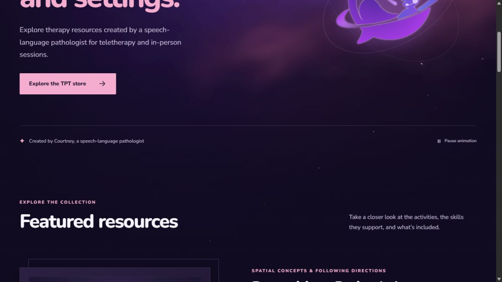
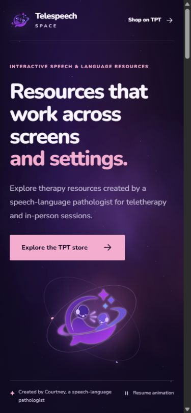

# Telespeech Space

A single-page marketing site with a dark purple and pink space background, the original SVG logo, product descriptions, Courtney's biography, and links to the TPT store.

The deployable website is **dist/index.html**. It contains its CSS, JavaScript, fonts, logo, and product artwork. No installation, external assets, or runtime dependencies are needed to view it.

All navigation and shopping links lead to:
https://www.teacherspayteachers.com/store/telespeech-space

There is no contact information, contact form, analytics, or tracking code. The full content, links, and FAQs work without JavaScript. JavaScript adds gentle entrance effects, the current year, and a motion toggle. The toggle remembers the visitor's preference on their device; system reduced-motion preferences take priority.

## Editing product descriptions

Edit **products.json**, not the generated HTML. Each product is a separate entry with these fields:

| Field | Content |
| --- | --- |
| `name` | Product name |
| `category` | A short description of the resource's focus |
| `image` | An image filename from `dist/assets` |
| `imageAlt` | A useful text description of the image |
| `description` | An array of paragraphs; add paragraphs as needed |
| `skills` | The skills the activity supports |
| `includes` | What comes with the resource |
| `requirements` | Device requirements and other practical details |

To add a product, copy an existing entry, change its fields, and add its image to `dist/assets`. Image formats: AVIF, PNG, JPG, and WebP. Order the entries in the order they should appear on the page. Product text is escaped during the build; use plain text, not HTML. Follow JSON syntax, including double quotes and commas between entries. The build reports missing fields or unsupported images.

After any edit:

1. Run `node build.cjs` in the project folder.
2. Run `node preview.cjs` and open http://127.0.0.1:4175 to review the page.
3. Commit the edited source, any new images, and **dist/index.html**, then push to GitHub.

The current workflow uses a content file; there is no browser-based editing dashboard or database. Descriptions are rendered at build time, so visitors can read them even with JavaScript disabled.

## Editing the design and biography

**page.html** contains the page structure, biography, styling, and browser JavaScript. **build.cjs** combines it with product content and assets into the self-contained HTML file. Run the build after edits to either source file.

The sole slogan is “Resources that work across screens and settings.” It appears once as the main heading. Section titles describe their content rather than introducing additional slogans. Decorative orbit lines and stars are circular; buttons and product layouts use rectangular edges rather than pill shapes or speech bubbles.

## Content and assets

- Original logo: the user-supplied `Telespeech Space Logo.svg`, preserved unchanged.
- Product artwork: Telespeech Space Teachers Pay Teachers storefront.
- Product copy: summaries of the product information reviewed from the storefront; confirm features and requirements when updating a listing.
- Biography: Courtney's supplied experience, approach, and education, edited for grammar and readability.
- Space background: lightweight embedded SVG stars, procedural clouds, and CSS color gradients.
- Nunito font: SIL Open Font License, included in `FONT-LICENSE.txt` and embedded in the HTML.
- Prices and customer ratings are omitted; TPT remains the source for purchase details.

## Sevalla deployment

Sevalla publishes the generated files already committed in `dist`:

- Repository: `scottie-peligro/TeleSpeech-Space`
- Branch: `main` (automatic deployments enabled)
- Build site before publishing: **Off**
- Root directory: `.`
- Publish directory: `dist`
- Index file: `index.html`

Do not run `npm install` or `npm run build` on Sevalla: this project has no npm dependencies or package.json. Build locally with `node build.cjs` and commit the generated output before pushing.

Site URL: https://telespeech-space-3wyt0.sevalla.page/

## Preview

