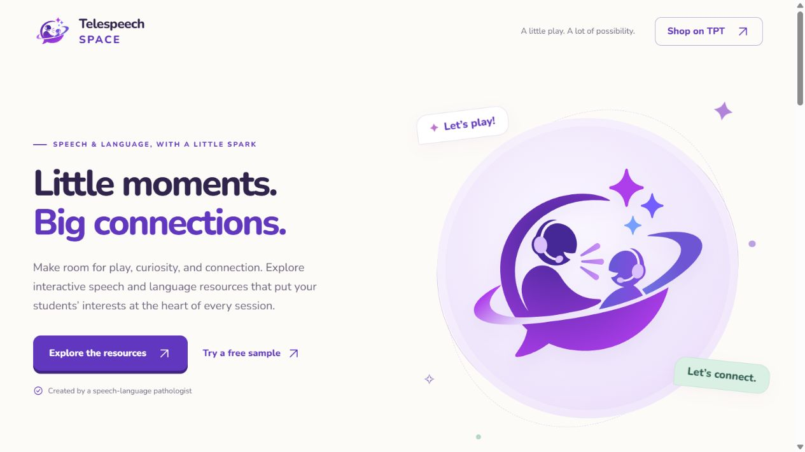

# Telespeech Space

The finished website is **dist/index.html**. Open this file in a browser or upload it as `index.html` to a static web host. It contains all CSS, JavaScript, fonts, the supplied SVG logo, and three product covers. No installation or build is needed to use it, and it does not request external assets.

All 11 navigation and product links lead to:
https://www.teacherspayteachers.com/store/telespeech-space

There is no contact section, contact information, form, analytics, or tracking code. The page works without JavaScript; JavaScript adds the current year, a header scroll style, gentle section entrance effects, and the FAQ's one-question-at-a-time behavior. Reduced-motion preferences are respected.

## Editing

`page.html` is the readable source. `dist/assets` contains the source artwork and font files. After edits, run `node build.cjs` to regenerate the self-contained `dist/index.html`. Run `node preview.cjs` for a loopback preview at http://127.0.0.1:4175.

## Content and assets

- Original logo: the user-supplied `Telespeech Space Logo.svg`, preserved unchanged.
- Product titles, product cover images, feature summaries, and Courtney's background: the live Telespeech Space Teachers Pay Teachers storefront, reviewed October 12, 2026. The marketing copy was written for this site. Prices and customer ratings are intentionally omitted so the store remains the source for current details.
- Featured products: Prepositions Potion Lab, Emoji Emotions, and Microwave Simulator.
- Nunito font: Google Fonts, SIL Open Font License. See `FONT-LICENSE.txt`; the license is also embedded in the HTML.

The repository contains the website files and editable source. To publish the site, upload `dist/index.html` to a static web host.

## Sevalla deployment

The site uses the generated static files already committed in `dist`.

- Repository: `scottie-peligro/TeleSpeech-Space`
- Branch: `main` (automatic deployments enabled)
- Build site before publishing: **Off**
- Root directory: `.`
- Publish directory: `dist`
- Index file: `index.html`

Sevalla should not run `npm install` or `npm run build`: this project has no npm dependencies or package.json. After editing `page.html` or assets, run `node build.cjs` locally and commit the updated `dist/index.html` along with the source before pushing. Sevalla then publishes the committed output.

Site URL: https://telespeech-space-3wyt0.sevalla.page/

## Preview

